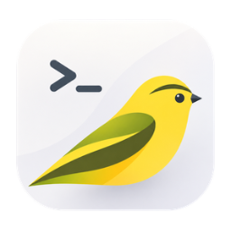
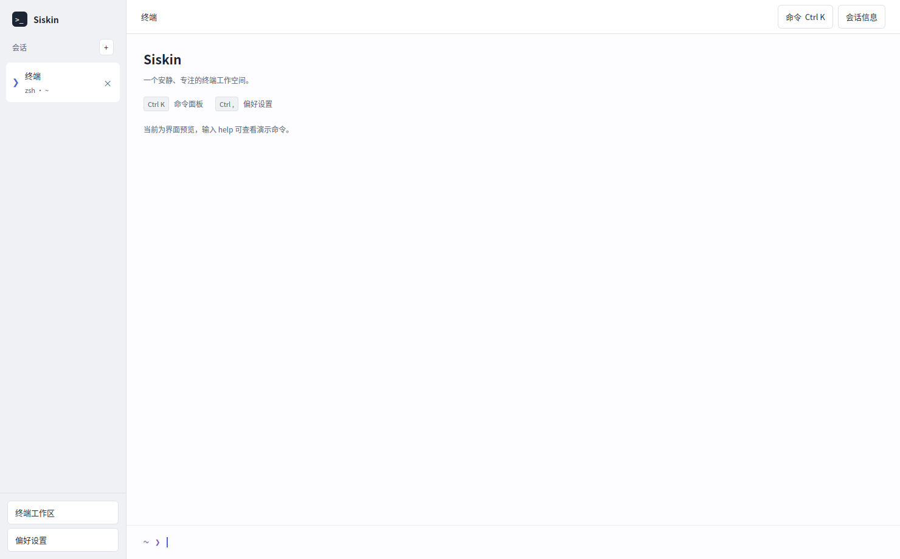
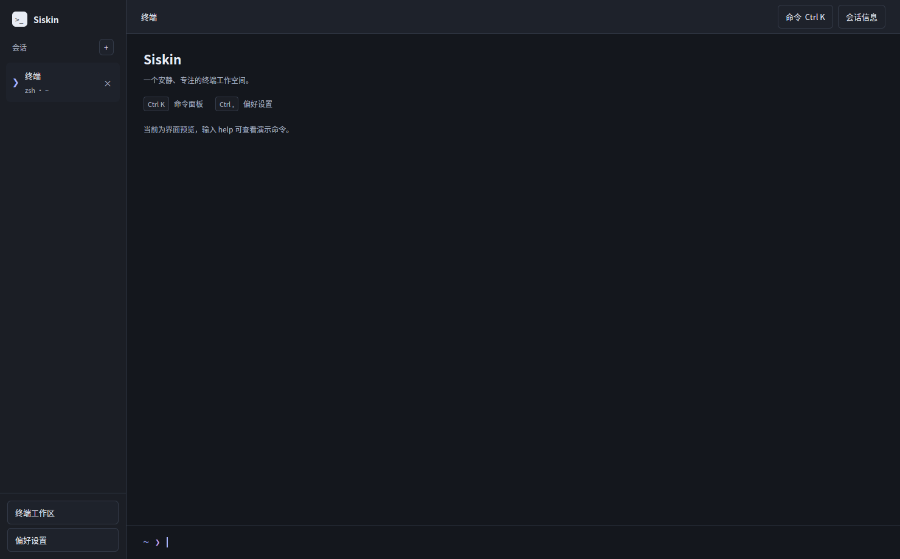
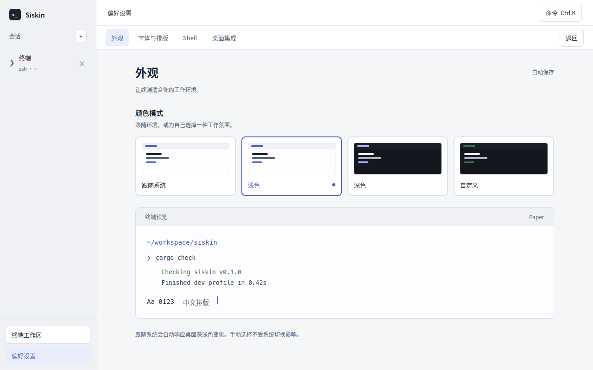

<!--
@Time    : 2026/11/5 20:00
@Author  : fzf
@FileName: README.md
@Software: Siskin
-->

# Siskin

一个安静、专注的 Linux 终端。真实 PTY、真实 VT 解析、真实输入法，
界面用 [`pulse-ui`](https://github.com/fzf54122/resource-pulse) + GPUI 绘制。

<p align="center">
  
</p>







## 这是什么

打开就是你的登录 shell。会话跑在独立的伪终端里，`alacritty_terminal`
负责 VT 状态机与网格，GPUI 负责把网格画到窗口上。

能做的事：

- `vim`、`htop`、`tmux`、`ssh`、`cargo watch` 正常工作，全屏 TUI 不乱位。
- 中文输入法组词、候选框跟随光标；提交前不写入 PTY。
- 鼠标拖选复制到 PRIMARY，`Ctrl+Shift+C/V` 走系统剪贴板，多行粘贴不会自动执行。
- 滚轮、`Shift+PageUp/PageDown` 回看滚动区，`Shift+End` 贴回底部。
- 主题、字体、Shell、字号改完立即生效并保存。

明确不做：SSH 客户端、分屏、标签拖拽重排、Windows / macOS 安装包、
sixel 与 kitty graphics protocol。Linux 之外的平台只保证能编译。

## 运行

```bash
git clone https://github.com/fzf54122/siskin.git
cd siskin
cargo run --locked
```

固定 Rust **1.98.1**。`pulse-ui` 以 Git tag `v0.1.1` 引入，GPUI 与它使用同一个
`zed-industries/zed` 提交 `c427327`，避免同一进程链接两份不兼容的框架。
首次构建需要联网拉取依赖。

需要 X11 / Wayland 图形会话和可用的 Vulkan 驱动。无显示器的终端跑不出窗口，
但单元测试与 PTY 集成测试可以在无显示器环境运行。

Ubuntu/Debian 构建依赖：

```bash
sudo apt-get install pkg-config clang cmake libxkbcommon-dev libxkbcommon-x11-dev \
  libwayland-dev libx11-xcb-dev libxcb1-dev libfontconfig1-dev libssl-dev \
  libzstd-dev libasound2-dev libgit2-dev libvulkan1 mesa-vulkan-drivers dbus-daemon
```

`dbus-daemon` 用于测试时启动隔离总线，不修改桌面正在使用的会话总线。

### 命令行

```bash
siskin                          # 用默认 shell 开一个会话
siskin -d ~/code/rust/siskin     # 指定起始目录
siskin -e htop                   # 直接执行命令，命令退出即关窗
siskin -V                        # 打印版本
```

`-e` 是终端惯例，IDE 与脚本集成会用到。命令启动失败时窗口保留并显示原因，
不会静默退出。

## 快捷键

终端动作统一用 `Ctrl+Shift+*`，避开 shell 与 readline 的常用组合。

| 按键 | 行为 |
| --- | --- |
| 直接输入 | 写入当前会话的 PTY |
| `Enter` / `Tab` / `Backspace` | 原样交给 shell |
| `Ctrl+A` … `Ctrl+Z` | 作为 C0 控制码下发（`Ctrl+C`、`Ctrl+D`、`Ctrl+Z` 正常） |
| `Alt+键` | 加 `ESC` 前缀 |
| `Ctrl+Shift+C` | 复制当前选区 |
| `Ctrl+Shift+V` / `Shift+Insert` | 粘贴；开启 bracketed paste 时自动包边界 |
| 中键 | 粘贴 PRIMARY |
| `Shift+PageUp/PageDown` | 向上 / 向下翻一页 |
| `Shift+Home` / `Shift+End` | 跳到滚动区顶 / 底 |
| 拖选 / `Shift+拖选` | 本地选区；应用开启鼠标上报时 `Shift` 强制本地 |
| `Ctrl+K` | 命令面板 |
| `Ctrl+,` | 打开设置 |
| `Ctrl+1` | 回到终端 |
| `Ctrl+Tab` / `Ctrl+Shift+Tab` | 切换会话 |
| `Ctrl+Shift+I` | 显示 / 收起右侧会话信息 |
| `Ctrl+Shift+T` | 循环切换主题模式 |
| `Ctrl+Shift+F` | 搜索滚动区；`Enter` 下一个，`Shift+Enter` 上一个，`Esc` 关闭 |
| `Ctrl+Click` | 打开光标下的链接或 `path:line:col` |
| `Ctrl+=` / `Ctrl+-` | 放大 / 缩小字号 |

应用开启鼠标上报（`vim` 的鼠标模式、`htop` 等）时，点击与滚轮会转成 SGR 序列发给程序，
此时按住 `Shift` 才能本地选字。

## 主题与字体

- 默认**跟随系统**，通过 GPUI 的桌面外观通知响应系统深浅色切换。
- 可固定浅色或深色；固定模式不受系统切换影响。
- 自定义主题支持深/浅底以及任意 `#RRGGBB` 强调色、终端底色和文字色。
- 点击颜色值后用 `Ctrl A` 重输，`Enter` 应用，`Esc` 取消；无效颜色不生效。
- 字体从已安装的等宽字体中选择，字号提供 11、12、13、14、16 px。
- 网格行列数由字体真实字形宽度推导，窗口缩放时同步 `TIOCSWINSZ`。

设置保存在 `$XDG_CONFIG_HOME/siskin/settings.json`；未设置 XDG 路径时使用
`~/.config/siskin/settings.json`。写入用临时文件 + `sync_all` + 原子替换，
文件损坏时只告警并保留原文件，不用默认值覆盖。

改动后 500ms 内的连续操作会合并成一次写入，退出前强制落盘。
配置带版本号，旧文件按 `v1 → v2` 的迁移链自动升级；版本比当前新时拒绝读取，
不会降级覆盖。

关闭窗口时会保存会话标题与工作目录，下次启动按快照恢复，但不恢复输出。

```json
{
  "version": 1,
  "theme_mode": "custom",
  "custom": {
    "dark": true,
    "accent": 0,
    "accent_rgb": "#61aaff",
    "background": "#101827",
    "foreground": "#e8edf2"
  },
  "font_family": "DejaVu Sans Mono",
  "font_size": 13,
  "shell": "bash"
}
```

`theme_mode` 可选 `system`、`light`、`dark`、`custom`。

## DDE 顶栏菜单

X11 下使用 `com.canonical.dbusmenu`，向 `com.canonical.AppMenu.Registrar`
注册窗口。支持 DDE 的 `dde-top-panel` + `dde-globalmenu-service`，
菜单为「文件 / 编辑 / 视图」。


应用不绘制最小化、最大化和关闭按钮，窗口装饰由桌面负责。
菜单点击通过异步事件唤醒 GPUI，不依赖键盘操作或下一次重绘。
顶栏服务重启后会重新注册；没有顶栏时仍可用命令面板与快捷键。
Wayland 全局菜单尚未验证。

菜单窗口属性使用 `_KDE_NET_WM_APPMENU_*` 的 **STRING** 类型。
不写 `_GTK_MENUBAR_OBJECT_PATH`：GTK 的 `org.gtk.Menus` 与 dbusmenu 不是同一种协议。

## 安装

```bash
cargo build --release --locked
python3 scripts/build_deb.py --skip-build
sudo apt install ./target/debian/siskin_0.2.0_amd64.deb
```

图标是成品位图组，放在 `assets/icons/`：`16/32/64/128/180/256/512/1024` 来自设计稿，
`22/24/48/96` 由 1024 等比缩小。打包按 hicolor 目录直接安装，`postinst` / `postrm`
负责刷新图标缓存与桌面数据库。

deb 只能在构建机同代发行版上安装，不承诺跨发行版 ABI 兼容。

## 结构

```text
src/
├── main.rs            命令行解析、窗口、菜单注册、应用组装
├── app/               应用状态，不依赖具体渲染
│   ├── mod.rs         SiskinApp 结构与查询方法
│   ├── session.rs     会话仓储与 PTY 持有
│   ├── events.rs      VT 事件消费、会话派生生命周期
│   ├── keys.rs        按键责任链
│   ├── actions.rs     Action 枚举与 dispatch
│   ├── clipboard.rs   系统剪贴板桥接
│   ├── palette.rs     命令面板状态
│   ├── prefs_ops.rs   设置加载 / 保存
│   ├── menu_ops.rs    全局菜单生命周期
│   ├── terminal_ops.rs 写入、选区、滚动、鼠标上报
│   └── theme_ops.rs   主题与取色
├── domain/            纯数据，不 use gpui / zbus
│   ├── action.rs      Action、ActionEffect
│   ├── key.rs         与框架无关的按键描述
│   ├── metrics.rs     字形度量与行列换算
│   ├── session.rs     SessionState 状态机、SessionSpec
│   └── shell_spec.rs  ShellKind → ShellSpec
├── io/                系统边界，不 use gpui
│   ├── pty.rs         PTY 派生、写端、resize、子进程回收
│   ├── vt/            alacritty_terminal 封装（event / view）
│   ├── ansi.rs        ANSI / 256 / truecolor → RGB
│   ├── keys.rs        按键 → PTY 字节、bracketed paste、鼠标上报
│   ├── preferences/   版本化配置与 Store trait
│   └── dbusmenu/      全局菜单
├── ui/                GPUI 视图
│   ├── mod.rs         Render 实现、字体度量
│   ├── grid/          自定义 Element：run 合并、整形、光标
│   ├── terminal.rs    终端卡片、鼠标选区、输入法
│   ├── sidebar.rs / workspace.rs / inspector.rs / palette.rs / preview.rs
│   └── settings/      appearance / colors / fonts / shell / desktop
├── theme/             配色、字体偏好
├── settings.rs        设置数据
└── tests/             keys / views / session / preferences / pty
```

数据流单向：键盘与输入法 → `io::keys` → PTY 写端；PTY 读端 →
`io::vt` → `Term` → `ui::grid` → 窗口。鼠标与滚轮由 `app` 决定走本地选区还是上报给程序。

## 验证

```bash
cargo fmt --all --check
cargo clippy --all-targets --locked -- -D warnings
cargo test --all-targets --locked
cargo build --locked
python3 scripts/check_structure.py --max-lines 400 --max-fn-lines 60
neo-runner run -f .agents/loop.yaml --output json
```

测试分层：

| 层 | 覆盖 |
| --- | --- |
| 单元 | VT 网格快照、ANSI 颜色、按键编码、尺寸换算、配置迁移 |
| 集成 | 真实 PTY 跑 `sh -c`，断言输出、退出码、resize、写入回显 |
| 协议 | 独立总线校验 dbusmenu 方法、子菜单深度、属性 |
| GUI | `TestAppContext` 模拟按键与点击 |

`scripts/check_desktop.py` 做 X11 实机验收：检查菜单属性、空闲时 D-Bus 动作与
深色设置重启恢复，使用临时配置目录。需要 `xdotool`、`gdbus`、`qdbus`、`xprop`、`busctl`。

`scripts/capture_window.py` 从指定窗口的合成像素图抓取，不会把遮挡其上的应用截进来，
用于像素比对。需要 Python 3、Pillow、libX11 与 libXcomposite，不是运行依赖。

发版前按 `docs/manual-checklist.md` 在真实桌面会话里逐条过一遍：PTY、输入法、
剪贴板、桌面集成、安装包与异常路径都在这份清单里。

## 已知限制

- **Wayland 输入法**依赖合成器的 `text-input-v3`。不可用时请切 X11。
- **全局菜单**只在 X11 验证；Wayland 下不注册全局菜单，用命令面板代替。
- **OSC 52** 默认只允许程序写剪贴板，禁止读系统剪贴板。
- **deb ABI** 只保证构建机同代发行版可安装。
- 未实现 sixel 与 kitty graphics protocol。

## 许可

Apache-2.0。
