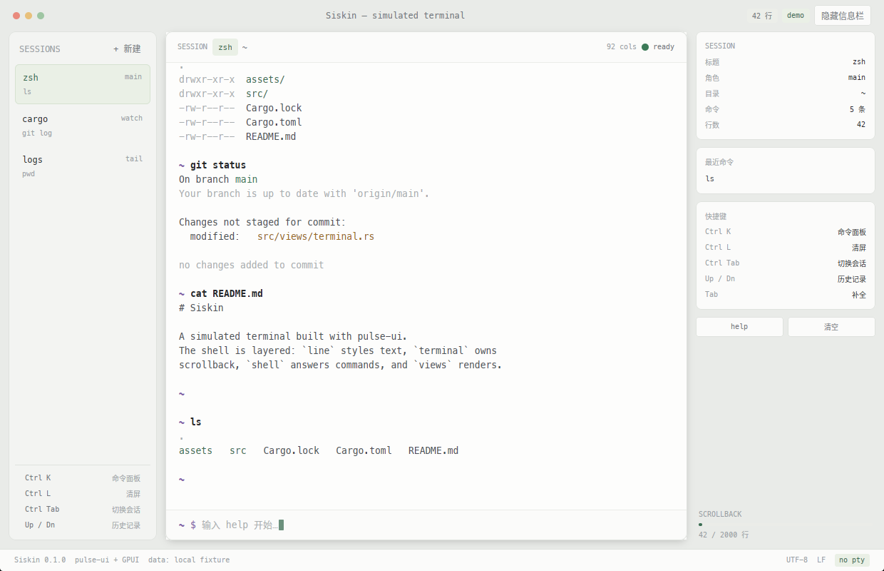

<!--
@Time    : 2026/11/4 19:40
@Author  : fzf
@FileName: README.md
@Software: Siskin
-->

# Siskin

用 [`pulse-ui`](https://github.com/fzf54122/resource-pulse) 搭的模拟终端。
窗口、排版、输入焦点都是真实的；命令输出和文件树是本地固定数据，不启动 PTY、不读写磁盘、不联网。

<p align="center">
  
</p>



## 这是什么

一个用来验证 `pulse-ui` 能不能撑起「像终端」的界面实验：
等宽正文、可滚动回看、真实键盘输入、命令面板，以及一整套浅色界面细节。
它不替代你的终端，但把终端里最常用的几件事做对了。

## 运行

```bash
git clone https://github.com/fzf54122/siskin.git
cd siskin
cargo run --locked
```

固定 Rust **1.98.1**。`pulse-ui` 以 Git tag `v0.1.1` 引入，GPUI 与它使用同一个
`zed-industries/zed` 提交 `c427327`，避免同一进程链接两份不兼容的框架。
首次构建需要联网拉取依赖。

需要 X11 / Wayland 图形会话和可用的 Vulkan 驱动。无显示器的终端跑不出窗口，
但测试可以在无显示器环境运行。

Linux 依赖参考 [`resource-pulse` 的 Linux 章节](https://github.com/fzf54122/resource-pulse#linux)。

## 已实现的交互

| 按键 | 行为 |
| --- | --- |
| 直接输入 | 写入当前会话的命令行 |
| `Enter` | 执行命令，输出追加到滚动区 |
| `Tab` | 命令名与路径前缀补全，只在结果唯一时补齐 |
| `Up` / `Down` | 浏览当前会话历史 |
| `PageUp` / `PageDown` | 回看滚动区，输入任意字符后贴回底部 |
| `Esc` | 清空当前输入行 |
| `Ctrl/⌘ K` | 打开命令面板（会话、清屏、重置、快捷键） |
| `Ctrl/⌘ L` | 清屏，保留目录与历史 |
| `Ctrl Tab` / `Ctrl Shift Tab` | 切换会话 |

支持的模拟命令：`ls [-l]`、`cd`、`pwd`、`cat`、`echo`、`git status|log`、
`cargo check|test|build`、`whoami`、`date`、`uname`、`siskin`、`help`、`clear`。
所有路径都会被限制在 `fs.rs` 里的只读文件树内。

## 结构

```text
src/
├── main.rs      窗口、应用标识与图标
├── app.rs       会话、状态机、按键分发、命令面板（不依赖渲染）
├── views.rs     窗口外壳、终端排版、面板与按钮
├── terminal.rs  滚动区与输入行，按列宽软换行
├── shell.rs     命令解析与回答
├── fs.rs        只读的模拟文件树
├── line.rs      带语义角色的文本片段
└── tests.rs     真实焦点、点击与键盘的 UI 测试
```

数据流向是单向的：`views` 只读状态并上抛事件，状态变化在 `app` 里发生，
文本换行在 `line`/`terminal` 完成，命令回答在 `shell` 完成。

## 验证

```bash
cargo fmt --all --check
cargo clippy --all-targets -- -D warnings
cargo test --all-targets
cargo build --locked
```

测试覆盖补全与历史的边界、滚动上限、路径穿越拒绝、换行不丢样式，
以及无显示器环境下的真实点击与键盘路径。GUI 测试不能替代实机字体与 GPU 验收。

## 设计说明

浅色单窗口、左侧会话栏、右侧信息栏，配色只用一个绿色强调色和一个暖色提示色，
其余都是结构灰。图标是一枚哑光深色圆球，上面是提示符 `>`、一个星形和一条暖色下划线。

## 许可

Apache-2.0。
